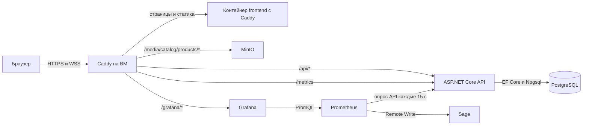
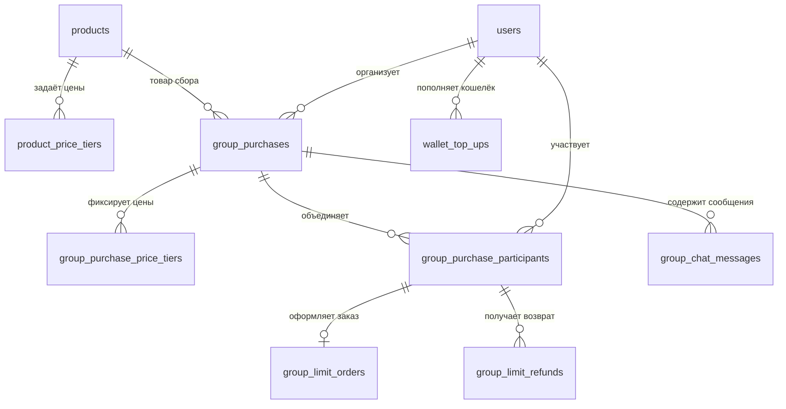

# Архитектура «Вместе»

Покупатель выбирает товар, количество и максимальную цену. API сохраняет предоплату и пересчитывает подходящий объём для каждой ценовой ступени. Участники видят ход сбора в браузере и могут обсуждать покупку в чате. Правила цены, подарка организатору и возвратов описаны в [спецификации MVP](group-purchases.md).

## Технологический стек проекта

| Часть системы | Стек |
| --- | --- |
| Фронтенд | React 18.3.1, TypeScript 5.8.3, React Router 6.30.1, TanStack React Query 5.83.0, Tailwind CSS 3.4.17, Vite 5.4.19. |
| Бэкенд | C# и ASP.NET Core 10, EF Core 10 с Npgsql, Mediator, FluentValidation, Mapster, JWT Bearer и BCrypt. |
| Данные | PostgreSQL 17 для предметных и финансовых данных, MinIO для изображений каталога, Redis 7 как провайдер распределённого кеша. |
| Наблюдаемость | Serilog, prometheus-net, Prometheus 3.13.5, Grafana 13.3.1, экспорт Prometheus Remote Write в Sage. |
| Доставка и проверки | GitLab CI, Kaniko, Spirit Registry, Docker Compose, Caddy 2. Бэкенд проверяют xUnit и Python e2e, фронтенд — ESLint, Vitest и React Testing Library. |

Устройство браузерного приложения, маршруты, состояние и обмен данными при оплате описаны отдельно. [Архитектура фронтенда](frontend-architecture.md)

## Как проходит запрос

Фронтенд использует React, TypeScript, React Router и TanStack Query. Каталог, профиль, кошелёк и заявки работают через HTTP. Для чата браузер держит отдельное WebSocket-соединение. Caddy обслуживает оба протокола на одном домене. В Compose также запущен Redis и зарегистрирован провайдер распределённого кеша. История чата и финансовые операции хранятся в PostgreSQL.

## Слои бэкенда

| Проект | Ответственность |
| --- | --- |
| `Backend.Api` | Контроллеры, HTTP-контракты в `Contracts`, обработчик WebSocket, аутентификация JWT, преобразование результатов в ответы. |
| `Backend.Application` | Команды и запросы, их обработчики и валидаторы, DTO и интерфейс `IAppDbContext`. |
| `Backend.Domain` | Сбор, участники, ценовые ступени и заказы. Здесь определяются достижимая цена, успех сбора и расчёт возврата. |
| `Backend.Infrastructure` | EF Core, миграции PostgreSQL, BCrypt для паролей, фоновые задачи завершения сборов и сбора метрик. |

Контроллер передаёт команду или запрос в Mediator. Его конвейер запускает FluentValidation, обработчик обращается к EF Core через IAppDbContext. API преобразует результат в публичный контракт с помощью Mapster. Ошибки бизнес-правил возвращаются как Problem Details с кодом в поле title, ошибки ввода дополнительно содержат разбивку по полям в errors.

При подтверждении заявки API проверяет пользователя по Bearer JWT. Обработчик команды проверяет цену, количество, обязательный адрес и доступный баланс. Обновление заявки и результат расчёта сохраняются в транзакции. Для повторов клиент передаёт один и тот же `Idempotency-Key`. Деньги хранятся в копейках, вес допускает точность до грамма. При снижении окончательной цены разница возвращается за всё купленное количество. По истечении срока незавершённые покупки обрабатывает фоновая задача.

## Покупка от выбора цены до заказа

1. **Создание.** Пользователь выбирает товар, личный максимум из его ценовых ступеней, количество, адрес и срок сбора. API создаёт сбор, записывает организатора первым участником и учитывает его предоплату. В сбор копируются единица продажи, цены, пороги и подарок товара. Эти условия сохраняются при дальнейших изменениях каталога.
2. **Предварительный расчёт.** Страница сбора запрашивает `GET /api/groups/{id}/limit/quote` с ценой и количеством. Сервер возвращает доступность средств, доплату или возврат при изменении заявки и сколько штук или килограммов осталось до цены. Такой запрос можно повторять, пока покупатель выбирает условия. Деньги списываются при подтверждении.
3. **Подтверждение.** Клиент передаёт заявку через `PUT /api/groups/{id}/limit`. В транзакции сервер заново проверяет срок сбора и остаток кошелька, доводит предоплату до выбранной цены, умноженной на количество, и пересчитывает достижимые ступени. При изменении той же заявки учитывается разница с её прежней предоплатой. Отзыв через `DELETE` возвращает оставшуюся предоплату.
4. **Успех.** Для каждой ступени доменная модель складывает количество всех подходящих покупок. Участник с максимумом 990 ₽ подходит и для цены 850 ₽. При первом достижении порога сбор сразу закрывается по самой дешёвой ступени, достижимой в этот момент. Подходящим заявкам создаются заказы, переплата возвращается в кошелёк. Заявка с максимумом ниже итоговой цены получает полный возврат. Организатору фиксируется подарок в количестве и единице, скопированных из товара.
5. **Истечение срока.** По истечении дедлайна открытый сбор переходит в `cancelled`. Участникам возвращаются предоплаты, прямые оплаченные заказы помечаются возвращёнными. Срок проверяется при записи и фоновым процессом с интервалом пять секунд. При успехе сервер сохраняет `successful`, цену и время. Интерфейс показывает «Доставлен» по правилам тестовой доставки, отдельного события от курьера в модели нет.

Например, пороги кофе составляют 3 шт. за 990 ₽ и 5 шт. за 850 ₽. Два покупателя сначала оставили заявки по 2 шт. с максимумом 850 ₽. Вместе у них 4 шт. для цены 850 ₽. Третий подтверждает 2 шт. с максимумом 990 ₽. Теперь на ступени 850 ₽ набрано 6 шт., сбор закрывается по 850 ₽. Первые двое уже внесли точную сумму, третий получает обратно **280 ₽** за две упаковки. Если бы порог 990 ₽ был достигнут отдельной, более ранней покупкой, сбор закрылся бы в тот момент.

Расчёт достижимой цены и переходы состояний находятся в доменной модели. Транзакцией предоплаты и возвратом сохранённого ответа при повторном запросе управляет обработчик заявки. При прямой покупке клиент сначала получает цену через `GET /api/groups/{id}/payment/quote`, затем подтверждает её через `POST /api/groups/{id}/payment`. Если цена выросла, сервер возвращает HTTP 409 и новый расчёт. При подтверждении допустимой цены заказ появляется сразу. Ранее внесённая предоплата этой заявки учитывается при проверке средств и возвращается при переходе к прямой покупке. [Правила сбора](https://gitlab.t-education.com/hack-ovb-02/backend/-/blob/34866ad/src/Backend.Domain/Groups/GroupPurchaseEntity.cs) · [Изменение заявки](https://gitlab.t-education.com/hack-ovb-02/backend/-/blob/34866ad/src/Backend.Application/Commands/Groups/ChangeGroupLimit.cs)

## Данные и согласованность

**Один покупатель в одном сборе.** Уникальный индекс по сбору и пользователю защищает запись участия. У этой записи есть количество, личный максимум, предоплата и возвраты. Заказ, если он появился, ссылается на участника своим первичным ключом. Поэтому число людей, купленное количество и количество заказов могут различаться.

**Один остаток кошелька для всех сборов.** API вычисляет баланс из пополнений, оплат и возвратов в PostgreSQL. Для совместимости с историческими данными запрос также учитывает ранее начисленные бонусы. При изменении заявки транзакция блокирует строку сбора, затем строки затронутых пользователей в порядке ID. Другой запрос с тем же кошельком проверит баланс после освобождения блокировки. Для предоплаченной заявки заказ, созданный при успехе, не вызывает повторного списания. [Расчёт баланса](https://gitlab.t-education.com/hack-ovb-02/backend/-/blob/34866ad/src/Backend.Application/Queries/Account/WalletBalance.cs)

**Повтор после потери связи.** Для изменения заявки результат операции хранится по тройке «сбор, пользователь, ключ». Если ответ потерян после фиксации транзакции, повтор с тем же ключом и данными возвращает записанный результат. Если с этим ключом передать другое количество, цену, карту или адрес, API отвечает конфликтом `IDEMPOTENCY_KEY_REUSED`. У создания сбора и пополнения кошелька отдельные ключи в рамках пользователя.

## Фронтенд и права доступа

| Сценарий | Кто и как получает данные |
| --- | --- |
| Витрина, сбор, участники и профиль организатора | Гость читает их по HTTP. В списке сборов фильтрация, сортировка и постраничная загрузка выполняются на сервере. В профиле авторизованный пользователь видит также состояние своего лайка. |
| Создание и участие | Нужен Bearer JWT. Организатор определяется связью пользователя с конкретным сбором. Тот же аккаунт может покупать в своих и чужих сборах. |
| Личный кабинет | API определяет владельца по токену. Клиент получает его сборы, баланс и уведомления. Уведомления строятся по заказам, время прочтения сохраняется в заказе. Колокол опрашивает API раз в 20 секунд. |
| Чат | Гость читает историю, сервер проверяет право отправки каждого сообщения. Обмен кадрами описан ниже. |

При входе или регистрации API выдаёт подписанный JWT, пароль хранится в виде BCrypt-хеша. Браузер хранит токен и время истечения в `localStorage`. При выходе, истечении срока или ответе `401` на запрос с текущим токеном клиент очищает сессию. Сервер ограничивает частоту запросов входа и регистрации, а также отправку сообщений в чате.

React Router связывает URL со страницами, TanStack Query управляет серверными данными. Открытый сбор обновляется раз в 10 секунд. После изменения покупки клиент сразу запрашивает свежие данные о сборе, участниках и балансе. Сообщения чата приходят по отдельному WebSocket. Полный справочник HTTP-контрактов генерируется из бэкенда. [Обновление данных в клиенте](https://gitlab.t-education.com/hack-ovb-02/frontend/-/blob/90aa03e/src/data.ts) · [Scalar на стенде](https://hack-ovb-02-vm1-369056.vm.prodcontest.com/api/scalar)

## Чат сбора

Браузер подключается к `wss://<домен>/api/groups/{groupId}/chat/ws`. Гость получает последние сообщения в кадре `ready`. Вошедший пользователь передаёт JWT в кадре `auth` и ждёт `authenticated`. При отправке сервер дополнительно проверяет срок действия токена и право писать в конкретный сбор.

| Действие | Обмен |
| --- | --- |
| Прочитать более ранние сообщения | Клиент отправляет `history` с `beforeId`. Ответ `history` содержит предыдущую страницу. По умолчанию страница содержит до 50 сообщений. |
| Отправить сообщение | Клиент отправляет `message` с текстом и `idempotencyKey`. После записи отправитель получает `sent`, подписчики получают `message`. Клиент объединяет сообщения по ID. |
| Восстановить соединение | Клиент переподключается с `afterId`, сервер читает пропущенные записи из PostgreSQL. При повторе неподтверждённого сообщения клиент использует прежний ключ. |

На стенде работает один экземпляр API. Список открытых соединений и уведомления о новых сообщениях находятся в памяти этого процесса. Перед запуском нескольких реплик потребуется связать их уведомления общей шиной. История и курсоры чата уже опираются на записи PostgreSQL.

## Метрики и доступ

Prometheus опрашивает внутренний `api:8080/metrics`. Те же метрики доступны по публичному `GET /metrics`. `GET /api/health` подтверждает, что процесс API отвечает. В этой проверке нет запроса к PostgreSQL или Redis. Grafana читает Prometheus внутри Docker-сети. При включённом Remote Write и настроенном ключе Prometheus отправляет ряды в Sage с метками `group=hack-ovb-02`, `system=vmeste-backend`, `env=stand` и `dc=ru-central1-d`. [Публичные метрики стенда](https://hack-ovb-02-vm1-369056.vm.prodcontest.com/metrics)

| Вопрос | Что смотреть |
| --- | --- |
| Чем закончились заявки «Куплю до»? | `vmeste_limit_applications{outcome="purchased"}` и остальные значения `outcome`. Это текущий исход последней заявки покупателя в сборе. |
| Как долго собирается нужный объём? | `vmeste_group_time_to_success_seconds` с `quantile="0.5"` и `quantile="0.95"` для успешно завершённых сборов. |
| Сколько и почему вернули? | `vmeste_refunds` и `vmeste_refunds_rubles` по `reason`. Причины возвратов предоплаты известны с момента внедрения журнала, исторические прямые возвраты восстановлены из заказов. |
| Как работает HTTP API? | RED показывает частоту запросов, долю 5xx и время ответа p95. WebSocket-соединения исключены из статистики длительности HTTP-запросов. |
| Хватает ли ресурсов PostgreSQL? | USE показывает занятость подключений, ожидающие блокировку сеансы и зарегистрированные взаимоблокировки. `vmeste_postgres_stats_up` показывает, состоялся ли последний опрос. |

Для проверки сбора метрик в Grafana откройте **Explore → Prometheus** и выполните `up{job="vmeste-api"}`. Значение `1` означает, что последний опрос удался. В поиске Sage выполните `pql up{group="hack-ovb-02",system="vmeste-backend",env="stand",job="vmeste-api"}` и проверьте время последней точки.

Prometheus вычисляет четыре правила оповещения. Они различают недоступный API, устаревшую статистику из PostgreSQL, открытые сборы после дедлайна и сбой фонового закрытия. Если API отвечает, а возврат задерживается, проверьте время последнего успешного закрывающего прохода (`vmeste_expiration_last_success_timestamp_seconds`) и ошибки фоновой задачи в JSON-логах API. Состояние правил доступно в Prometheus. Отправка оповещений команде через Alertmanager в Compose не настроена. [Правила Prometheus](https://gitlab.t-education.com/hack-ovb-02/backend/-/blob/34866ad/infra/monitoring/prometheus/alerts.yml)

### Учётная запись Grafana учебного стенда

| Поле | Значение |
| --- | --- |
| Адрес | [Grafana](https://hack-ovb-02-vm1-369056.vm.prodcontest.com/grafana/) |
| Логин | `admin` |
| Пароль | `3bb228e34eb7fb144d330e910471e8b9e3269dd7b067e964ad24b93490bb5001` |

Основной дашборд показывает заявки, возвраты, сроки и доступность API. Отдельный дашборд показывает RED для HTTP и USE для PostgreSQL. [API и сборы](https://hack-ovb-02-vm1-369056.vm.prodcontest.com/grafana/d/vmeste-overview) · [RED и USE](https://hack-ovb-02-vm1-369056.vm.prodcontest.com/grafana/d/vmeste-red-use)

## Сборка и выкладка

Бэкенд и фронтенд выпускаются отдельными пайплайнами GitLab. Проверки выполняются для merge request и повторяются на коммите в `master`. Бэкенд запускает .NET unit-тесты и e2e на отдельных PostgreSQL и Redis, включая миграцию с предыдущей схемы. Фронтенд запускает тесты расчёта заявки, валидации адреса и поведения WebSocket-чата, а также линтер и production-сборку.

После проверок в `master` CI публикует образ с тегом коммита в Spirit Registry и обновляет Docker Compose на ВМ по SSH. При изменении протокола чата сначала выкладывается поддерживающий его API, затем клиент. Гостевое соединение на стенде можно проверить по кадру `ready` при открытии существующего сбора. [Бэкенд](https://gitlab.t-education.com/hack-ovb-02/backend) · [Фронтенд](https://gitlab.t-education.com/hack-ovb-02/frontend)

На ВМ два проекта Compose. Внешний Caddy из проекта бэкенда принимает соединения на 80/443 и через общую сеть `vmeste-web` передаёт страницы контейнеру фронтенда. Внутри него другой Caddy отдаёт файлы сборки и `index.html` для прямых переходов по маршрутам React. PostgreSQL, Redis, MinIO и Prometheus доступны в сети бэкенда. Для изображений Caddy пропускает только чтение каталога товаров. PostgreSQL, объекты MinIO, данные мониторинга и сертификаты Caddy хранятся в именованных томах.

При запуске API применяет миграции EF Core. Оба скрипта выкладки ждут готовности контейнеров перед сохранением версии релиза. При ошибке запуска фронтенд пытается вернуть предыдущую версию из `release.env`, если она есть. У бэкенда автоматический откат образа и миграций в скрипте отсутствует. Одна ВМ остаётся общей точкой отказа. Именованные тома переживают пересоздание контейнера, но восстановление после потери ВМ требует отдельной резервной копии. В репозиториях проекта процедура такого восстановления не описана. [Compose стенда](https://gitlab.t-education.com/hack-ovb-02/backend/-/blob/34866ad/deploy/compose.production.yaml) · [Выкладка бэкенда](https://gitlab.t-education.com/hack-ovb-02/backend/-/blob/34866ad/deploy/rollout.sh) · [Выкладка фронтенда](https://gitlab.t-education.com/hack-ovb-02/frontend/-/blob/90aa03e/deploy/rollout.sh)
