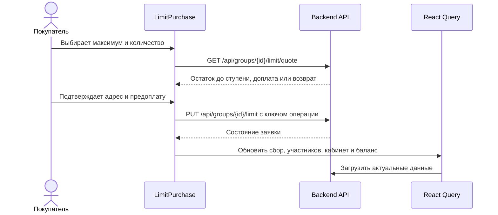

# Архитектура фронтенда «Вместе»

Витрина, оформление покупки и личный кабинет работают как React SPA. Браузер загружает статическую сборку, открывает нужную страницу по URL и обращается к бэкенду на том же домене. HTTP обслуживает каталог, кошелёк и заказы. Для чата страницы сбора браузер открывает WebSocket. [Исходный код](https://gitlab.t-education.com/hack-ovb-02/frontend/) · [Архитектура системы](architecture.md)

## Технологический стек

| Область | Технологии | За что отвечают |
| --- | --- | --- |
| Интерфейс и типы | React и React DOM 18.3.1, TypeScript 5.8.3 | Компоненты, формы, типы запросов и ответов. Сборка проверяет `src` в строгом режиме TypeScript. |
| Навигация | React Router DOM 6.30.1 | URL страниц, параметры сбора и товара, возврат к оформлению после входа. |
| Серверные данные | TanStack React Query 5.83.0, браузерный Fetch API | Кеш запросов, пагинация, фоновое обновление и отправка изменений. |
| Чат | Браузерный WebSocket API | Прямая подписка на сообщения, загрузка истории и переподключение по курсору. |
| Оформление | Tailwind CSS 3.4.17, PostCSS 8.5.6, Autoprefixer 10.4.21 | Общие цвета и шрифты заданы в теме Tailwind. Адаптивная вёрстка и стили компонентов находятся в `src/index.css`. |
| Элементы интерфейса | Lucide React 0.462.0, qrcode.react 4.2.0, Rubik и PT Serif через Fontsource | Иконки, QR-код приглашения, шрифты в статической сборке. |
| Сборка и раздача | Vite 5.4.19, React SWC plugin 3.11.0, Docker, Caddy 2 | Преобразование TSX, сборка файлов в `dist/`, раздача SPA в контейнере. |
| Проверки | ESLint 9.32.0, Vitest 3.2.6, React Testing Library 16.3.3, jsdom 26.1.0 | Проверка исходников, расчёта заявки и поведения компонентов. Задача GitLab CI выполняется на Node.js 22. |

Версии npm-пакетов взяты из lock-файла релиза. [package-lock.json](https://gitlab.t-education.com/hack-ovb-02/frontend/-/blob/90aa03e/package-lock.json)

## Как устроен клиент

`src/main.tsx` создаёт один React root, подключает `BrowserRouter` и общий `QueryClientProvider`. В `src/App.tsx` маршруты вложены в `Layout`, поэтому навигация, вход и колокол уведомлений доступны на разных страницах. По прямой ссылке Caddy отдаёт `index.html`, после чего React Router выбирает экран.

| Маршрут | Экран и его ответственность |
| --- | --- |
| `/`, `/products/:id` | Витрина и карточка товара. Покупатель смотрит цены и выбирает товар для сбора. |
| `/new`, `/products/:id/create` | Выбор товара и создание сбора. Форма ведёт от условий к адресу и подтверждению предоплаты. Для подтверждения нужен вход. |
| `/groups` | Список сборов. Поиск, фильтры, сортировка и смещение страницы передаются в API. |
| `/groups/:code`, `/invite/:code` | Оба маршрута открывают `GroupPage`. Страница объединяет условия, личную заявку, список участников, приглашение и чат. |
| `/me`, `/organizers/:id`, `/users/:id` | Личный кабинет и публичные профили. Переход на собственный профиль ведёт в кабинет. |
| `/login`, `/register` | Формы входа и регистрации. Для защищённых страниц `Protected` сохраняет исходный путь в параметре `next`. |

Страницы в `src/pages/` собирают экран. Компоненты в `src/components/` отвечают за конкретные действия, например `LimitPurchase` за заявку, `Wallet` за кошелёк и `GroupChat` за переписку. Общие типы контрактов объявлены в `src/types.ts`. Форматирование денег и количества, проверка адреса и предварительный расчёт вынесены в `format.ts`, `address.ts` и `groupPricing.ts`. [Маршруты](https://gitlab.t-education.com/hack-ovb-02/frontend/-/blob/90aa03e/src/App.tsx) · [Страница сбора](https://gitlab.t-education.com/hack-ovb-02/frontend/-/blob/90aa03e/src/pages/Group.tsx)

## Где живут данные

| Данные | Кто ими управляет | Когда обновляются |
| --- | --- | --- |
| Цены, участники, заказы, баланс | Бэкенд хранит данные. React Query кеширует ответы в памяти вкладки. Ключи личных запросов учитывают пользователя. | Страница открытого сбора опрашивает API каждые 10 секунд, список сборов — каждые 30, личные сборы и баланс — каждые 15. Успешная покупка инициирует обновление связанных запросов. |
| Черновик покупки | Компонент формы хранит количество, цену, адрес и открытый шаг подтверждения. | При вводе интерфейс пересчитывает прогноз. Итоговую стоимость и доступность средств подтверждает API. |
| Вход в аккаунт | `session.ts` хранит токен, пользователя и срок действия в `localStorage`. Компоненты подписываются через `useSyncExternalStore`. | Выход, истечение срока и ответ 401 для текущего токена очищают сессию. Событие `storage` синхронизирует вкладки. |
| Сообщения чата | Бэкенд сохраняет историю. `GroupChat` держит видимые сообщения, курсор и черновик в памяти компонента. | При входе приходят последние сообщения, при переподключении клиент запрашивает пропущенные по `afterId`. Полученные записи объединяются по ID. |

`src/api.ts` добавляет к пути префикс `/api`, передаёт JWT и ключ идемпотентности, преобразует ошибки API в текст формы. Общие запросы и правила обновления находятся в `src/data.ts`. Мутации по умолчанию имеют отключённый автоматический повтор. [HTTP-клиент](https://gitlab.t-education.com/hack-ovb-02/frontend/-/blob/90aa03e/src/api.ts) · [Кеш и обновления](https://gitlab.t-education.com/hack-ovb-02/frontend/-/blob/90aa03e/src/data.ts)

## Как форма «Куплю до» подтверждает покупку

Локальный прогноз позволяет увидеть эффект выбора до ответа сервера. Для вошедшего покупателя форма ждёт успешного расчёта API и достаточного баланса перед отправкой. При редактировании предварительный расчёт заменяет прежнее количество участника. При повторной отправке той же формы компонент использует тот же ключ операции. Если сервер вернул ошибку, форма запрашивает свежую цену и состояние сбора. [Форма заявки](https://gitlab.t-education.com/hack-ovb-02/frontend/-/blob/90aa03e/src/components/LimitPurchase.tsx)

## Чат, тесты и выпуск

Компонент чата владеет соединением, пока открыта страница сбора. Гость получает историю после кадра `ready`. Для вошедшего пользователя компонент отправляет токен отдельным кадром и ждёт подтверждения перед отправкой сообщения. После разрыва задержка повторного подключения растёт от 0,5 до 10 секунд. При уходе со страницы компонент закрывает сокет и таймеры. [Клиент чата](https://gitlab.t-education.com/hack-ovb-02/frontend/-/blob/90aa03e/src/components/GroupChat.tsx)

В CI `npm ci` устанавливает зависимости из lock-файла. Затем запускаются линтер, тесты и production-сборка. Тесты покупки проверяют расчёт цены, возврат, количество и адрес. Компонентные тесты чата проверяют получение истории, авторизацию, переподключение и повтор отправки с управляемым WebSocket в jsdom. Проверка типов входит в `npm run build` перед Vite. [Тесты покупки](https://gitlab.t-education.com/hack-ovb-02/frontend/-/blob/90aa03e/tests/checkout.test.js) · [Тесты чата](https://gitlab.t-education.com/hack-ovb-02/frontend/-/blob/90aa03e/tests/chat.test.jsx)

В разработке Vite проксирует HTTP и WebSocket по пути `/api` на `API_PROXY_TARGET`. На стенде внешний Caddy направляет запросы к API и к статическому фронтенду. В итоговом образе фронтенда Caddy читает файлы из `/srv`. Замена версии клиента происходит через отдельный Compose-проект. [Конфигурация Vite](https://gitlab.t-education.com/hack-ovb-02/frontend/-/blob/90aa03e/vite.config.ts) · [Dockerfile](https://gitlab.t-education.com/hack-ovb-02/frontend/-/blob/90aa03e/Dockerfile)
