# Карта пользовательских историй проекта «Вместе»

## Сценарии в интерфейсе

Каждая цепочка читается слева направо. Нажмите на снимок, чтобы открыть экран в полном размере. Три сценария пройдены в локальном «Вместе» с тестовыми кошельками. В примере три пачки кофе стоят по 990 ₽, пять — по 850 ₽.

### А. Организатор открывает сбор и приглашает коллег

Маша хочет одну пачку кофе и готова заплатить до 850 ₽. Она выбирает срок, указывает адрес и первой вносит предоплату.

| 1. Выбрать цену, количество и срок | 2. Подтвердить адрес и предоплату | 3. Открыть приглашение |
| --- | --- | --- |
| [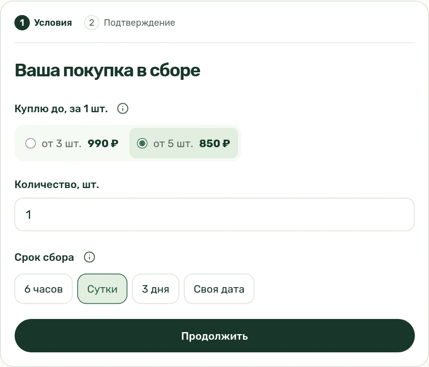](assets/user-story-map/a-choose.webp) | [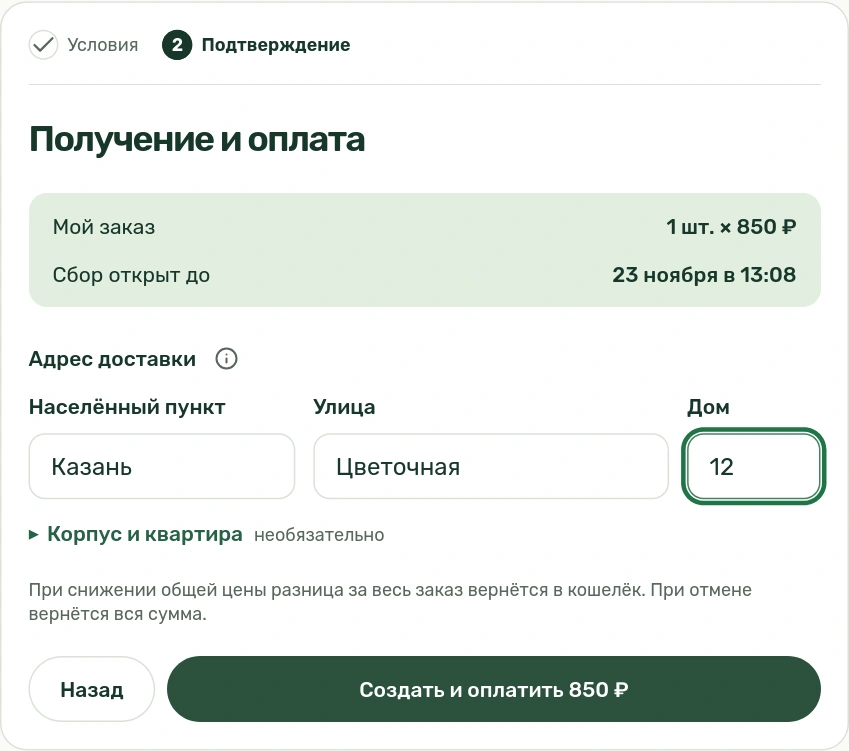](assets/user-story-map/a-confirm.webp) | [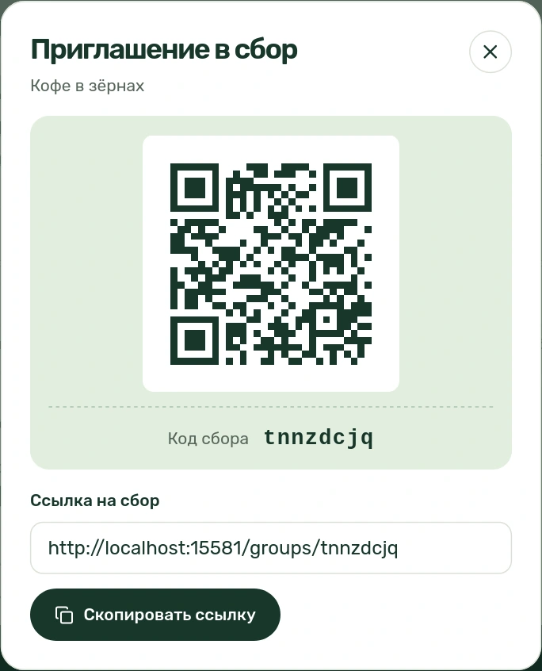](assets/user-story-map/a-invite.webp) |

**Итог.** Сбор открыт. Пачка Маши учитывается при цене 850 ₽, а коллеги могут вступить по коду, ссылке или QR.

### Б. Покупатель оплачивает сейчас и получает разницу

У Маши одна пачка до 850 ₽. Рома выбирает «Оплатить сейчас» и покупает две пачки по 990 ₽. Позже Лена добавляет ещё две пачки до 850 ₽.

| 1. Подтвердить 1 980 ₽ | 2. Проверить оплаченный заказ | 3. Увидеть итоговую цену и возврат |
| --- | --- | --- |
| [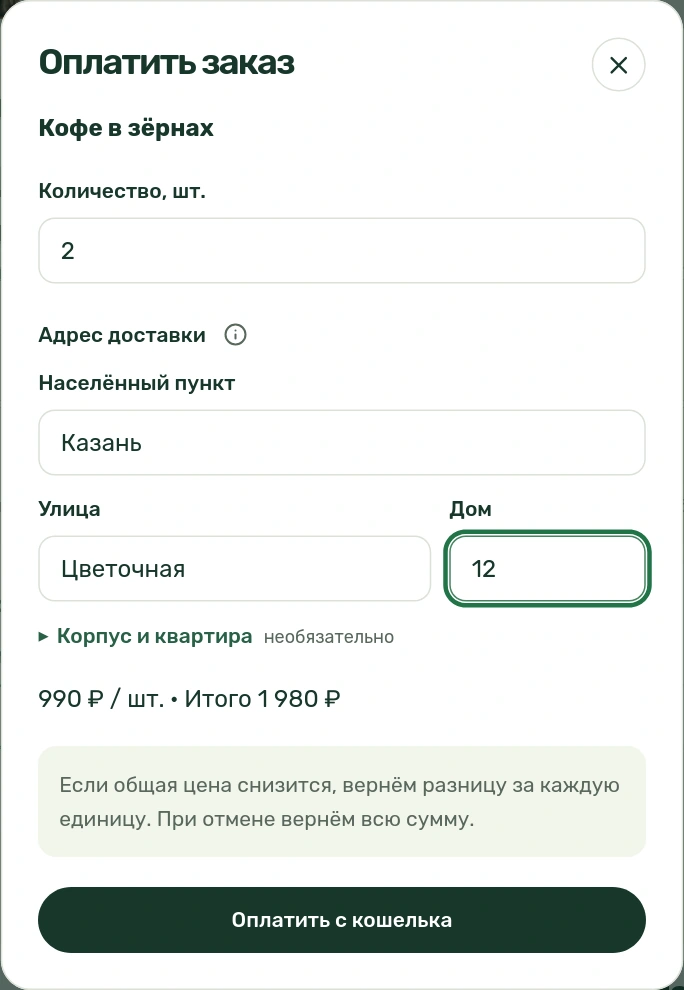](assets/user-story-map/b-checkout.webp) | [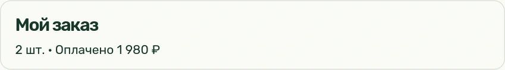](assets/user-story-map/b-paid.webp) | [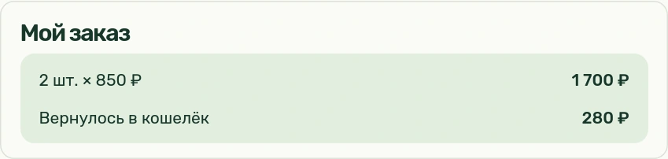](assets/user-story-map/b-refund.webp) |

**Итог.** Пять пачек стоят по 850 ₽. Заказ Ромы обошёлся в 1 700 ₽, а 280 ₽ вернулись в кошелёк.

### В. Покупатель задаёт максимум и дожидается своей цены

В другом сборе у Маши тоже одна пачка до 850 ₽. Лена берёт две с таким же лимитом. После предоплаты в сборе три пачки из пяти. Затем ещё один покупатель добавляет две.

| 1. Выбрать две пачки до 850 ₽ | 2. Подтвердить предоплату | 3. Проверить, сколько осталось | 4. Открыть исполненный заказ |
| --- | --- | --- | --- |
| [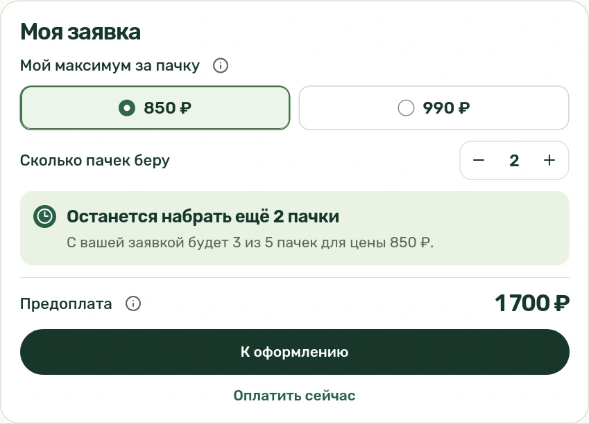](assets/user-story-map/c-limit.webp) | [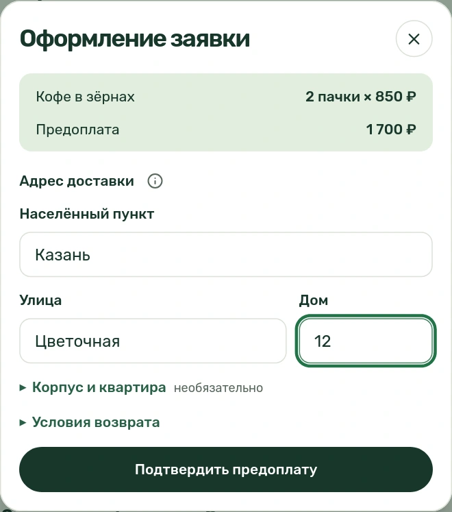](assets/user-story-map/c-confirm.webp) | [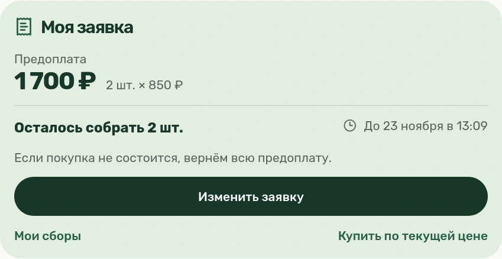](assets/user-story-map/c-wait.webp) | [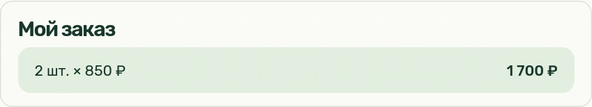](assets/user-story-map/c-order.webp) |

**Итог.** Как только набралось пять пачек, заявка Лены стала заказом. Внесённые 1 700 ₽ полностью покрыли покупку.

## Карта по этапам покупки

Карта читается слева направо. Зелёные карточки показывают решения покупателя, персиковые — действия организатора, белые — дополнительные возможности. Один человек может выступать в обеих ролях.

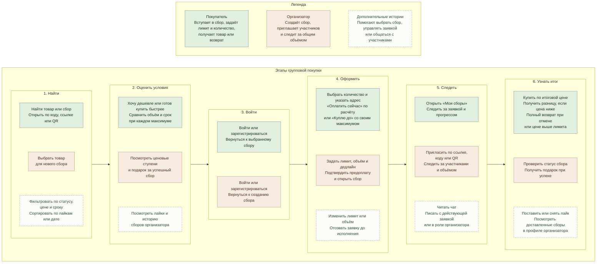

## Покупатель выбирает между ценой и скоростью

**Хочу дешевле.** «Мне нужны две пачки кофе. Я готов заплатить до 850 ₽ за пачку. Хочу увидеть, сколько ещё нужно собрать с учётом моих двух пачек, чтобы решить, стоит ли ждать».

**Готов купить быстрее.** «За те же две пачки я готов заплатить до 990 ₽, если с моей заявкой сбор закроется прямо сейчас. Перед подтверждением хочу увидеть итоговую цену и сколько спишется с кошелька».

У кофе две ступени — 990 ₽ от 3 пачек и 850 ₽ от 5. В открытом сборе уже ждут два покупателя. Первый заказал одну пачку с максимумом 990 ₽, второй — одну с максимумом 850 ₽. Посмотрим, что произойдёт, если третий покупатель добавит две пачки.

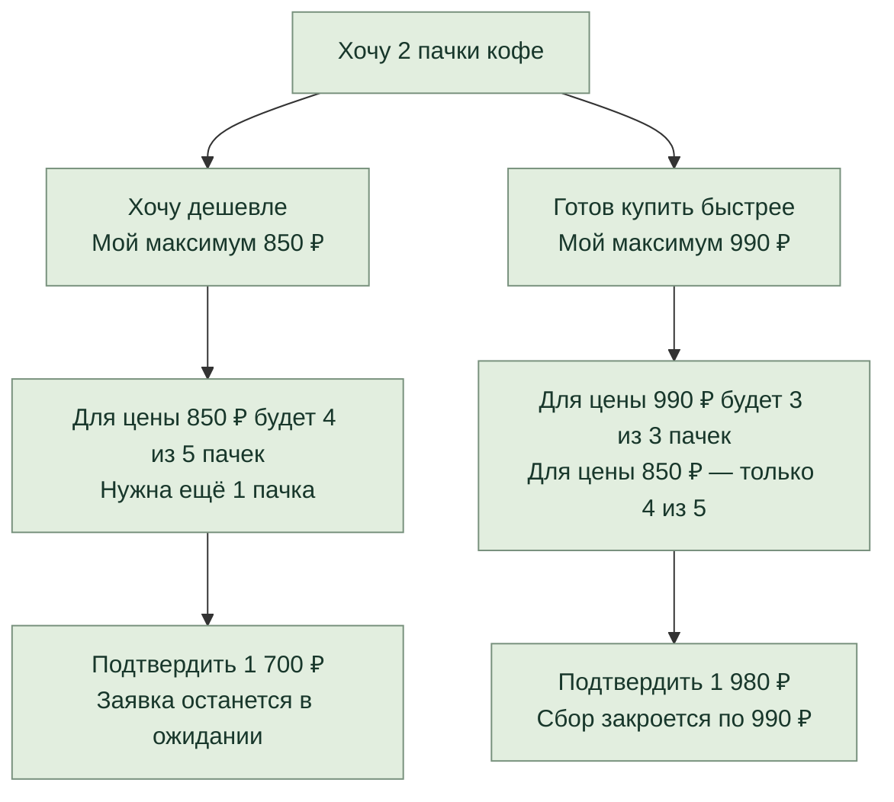

В обоих случаях покупатель оформляет одну и ту же заявку «Куплю до». Личный максимум определяет, для каких ступеней подходят его две пачки. Если за время оформления поступит ещё одна заявка, при подтверждении сервер пересчитает результат.

## Покупатель выбирает «Оплатить сейчас» или «Куплю до»

**Оплатить сейчас.** «Я хочу две пачки кофе и согласен на цену, которую вижу при оформлении. Хочу сразу увидеть оплаченный заказ в личном кабинете. Если сбор достигнет более дешёвой ступени, ожидаю возврат за обе пачки».

**Куплю до.** «Я возьму те же две пачки только по 850 ₽ или дешевле. Готов внести предоплату сейчас и подождать. Пока заявка ожидает, хочу иметь возможность изменить количество или отозвать её».

Возьмём другой открытый сбор с теми же ступенями — 990 ₽ от 3 пачек и 850 ₽ от 5. Организатор уже внёс предоплату за **1 пачку с максимумом 850 ₽**. Покупатель открывает этот сбор и выбирает **2 пачки**. Ниже два варианта для одного и того же покупателя при одинаковых исходных условиях.

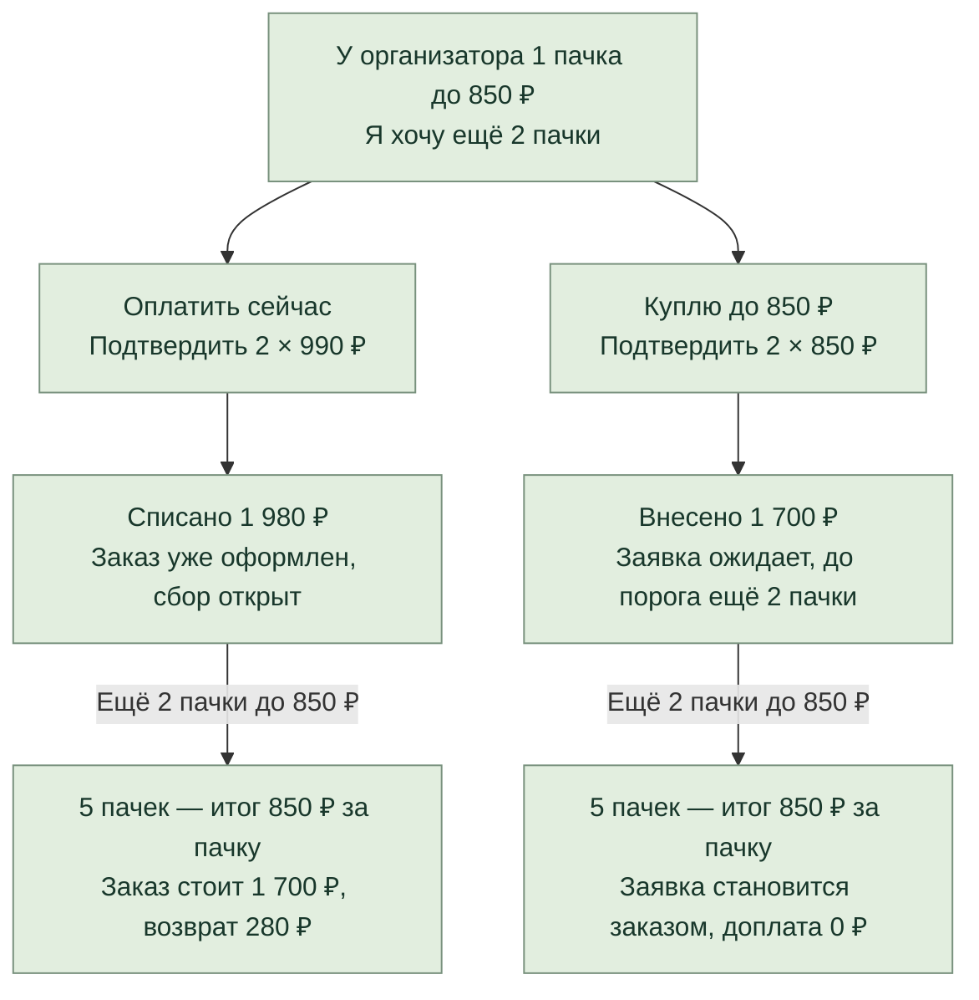

Почему прямая оплата здесь начинается с 990 ₽? На ступени 990 ₽ подходят только две пачки покупателя, поскольку максимум организатора ниже. Для ступени 850 ₽ подходят все три пачки, но нужны пять. Поэтому прямая покупка оформляется по стартовой цене сбора. Если уже при оформлении достигается ступень 850 ₽, расчёт сразу покажет **1 700 ₽ за две пачки**.

Если срок истечёт до достижения порога, в этом примере на кошелёк вернётся **1 980 ₽** при прямой оплате или **1 700 ₽** по ожидающей заявке. В общем случае итоговая цена выше личного максимума означает полный возврат ожидающей заявки. Для прямого заказа действует цена, подтверждённая при оплате, с возвратом разницы при её снижении.

## Организатор открывает сбор и приглашает людей

«Я хочу заказать 2 кг яблок и готов подождать скидку. До открытия сбора мне важно знать свою предоплату и срок. Когда сбор открыт, хочу отправить друзьям ссылку и видеть, сколько килограммов ещё нужно».

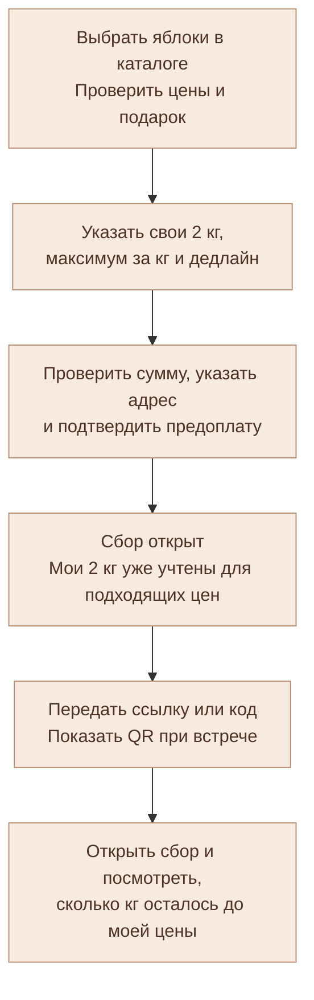

Организатор выбирает цену своей покупки наравне с участниками. Подарок задаёт товар. Если в условиях яблок указано 5 кг в подарок и сбор успешен, организатору начисляются эти 5 кг. Его собственные 2 кг оформляются по правилам личного максимума.

## Покупатель меняет ожидающую заявку

«В “Моих сборах” я вижу предоплату за две пачки. Теперь мне нужна только одна. Хочу уменьшить количество и сразу понять, сколько вернётся в кошелёк».

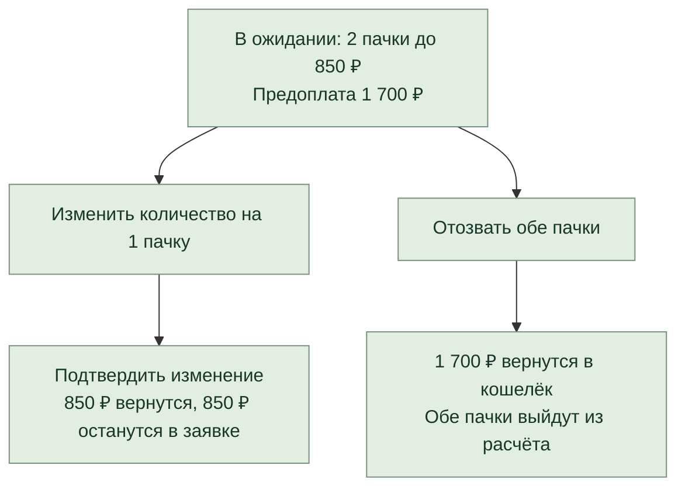

## Покупатель проверяет итог

«Я заранее внёс деньги и хочу увидеть в личном кабинете три вещи — сколько товара купил, по какой цене и какая сумма вернулась в кошелёк».

Здесь две **отдельные** заявки по две пачки. Одна внесена с максимумом 990 ₽, другая — с максимумом 850 ₽. Для каждой показаны возможные исходы при разных результатах сбора.

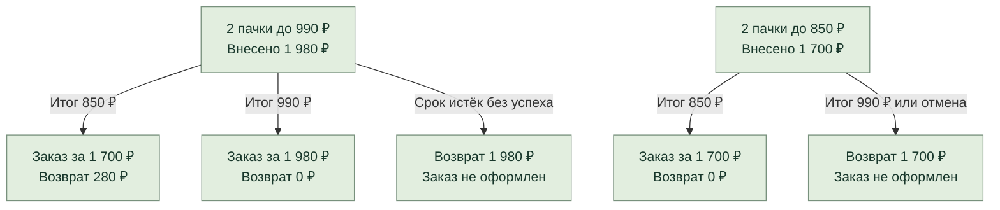

Правила расчёта и критерии приёмки собраны в [спецификации MVP](group-purchases.md).
